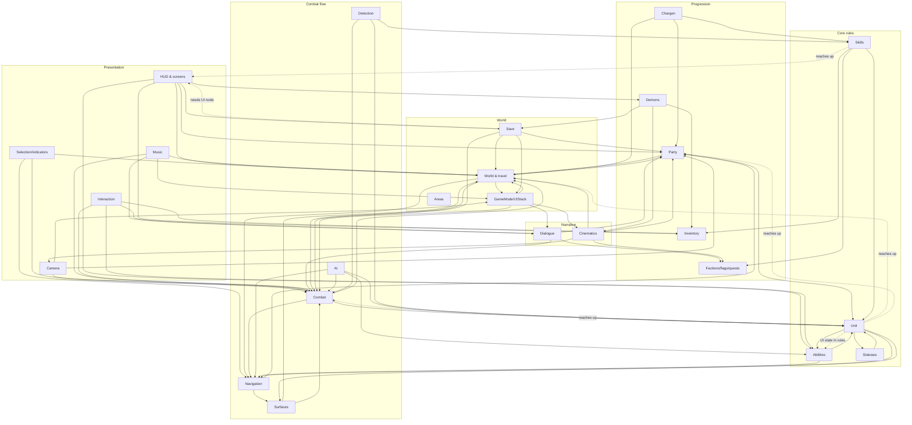

# Systems map

The game, broken into 25 systems. Each doc follows [_TEMPLATE.md](_TEMPLATE.md): purpose, owned state, public surface, dependencies, assumptions, lifecycle, known issues, tests. Every claim carries a file:line.

**How to use this:** before touching a system, read its doc instead of reasoning from memory. After fixing it, update its Known issues table (mark rows FIXED with the commit) and any section the fix changed. A doc that disagrees with the code is a bug in the doc.

Mapped 2026-10-29 at commit 28ba573. Issue counts are rows in each doc's Known issues table.

## Index

| Layer | System | Doc | Issues |
|---|---|---|---|
| **Core rules** | Unit (stats, combat, movement, death, statuses on a unit) | [unit.md](unit.md) | 20 |
| | Abilities & effects | [abilities.md](abilities.md) | 9 |
| | Status effects (definitions, behaviors) | [statuses.md](statuses.md) | 7 |
| | Skills | [skills.md](skills.md) | 8 |
| **Combat flow** | Combat (CombatManager, Encounter, turns) | [combat.md](combat.md) | 12 |
| | AI (CombatAi, scorer, archetypes) | [ai.md](ai.md) | 12 |
| | Surfaces | [surfaces.md](surfaces.md) | 7 |
| | Detection (notice, join, flee) | [detection.md](detection.md) | 7 |
| | Navigation (grid, routes, formation) | [navigation.md](navigation.md) | 7 |
| **World** | World & travel (WorldManager, WorldContext, AreaState) | [world.md](world.md) | 8 |
| | Areas & bootstrap (MainRoot, game areas, debug spawner) | [areas_bootstrap.md](areas_bootstrap.md) | 8 |
| | Save/load | [save.md](save.md) | 7 |
| | Game mode & UI stack | [mode_and_ui_stack.md](mode_and_ui_stack.md) | 5 |
| **Party & progression** | Party (PartyManager, groups, leader) | [party.md](party.md) | 9 |
| | Demons (roster, compendium, fusion) | [demons.md](demons.md) | 8 |
| | Inventory, stash, currency | [inventory.md](inventory.md) | 11 |
| | Factions, flags, quests | [factions_flags_quests.md](factions_flags_quests.md) | 9 |
| | Character creation | [character_creation.md](character_creation.md) | 6 |
| **Narrative** | Dialogue & negotiation | [dialogue.md](dialogue.md) | 11 |
| | Cinematics | [cinematics.md](cinematics.md) | 7 |
| **Input & presentation** | Interaction (menu, click routing) | [interaction.md](interaction.md) | 3 |
| | Selection & indicators | [selection_indicators.md](selection_indicators.md) | 5 |
| | Camera | [camera.md](camera.md) | 6 |
| | HUD & screens (+ log) | [ui.md](ui.md) | 12 |
| | Music & audio | [music.md](music.md) | 5 |

## Dependency map

Arrows point from a system to what it reaches into. Lower layers should not reach up; the dotted edges are places they do.

Worst upward reaches, each a known issue:
- **Rules read UI state:** `unit_combat.gd:211-213` reads `AbilityManager.armed_ability` (unit.md #14).
- **Rules and save depend on a screen:** inventory lives on `ui/party_overview.gd`, so Save refuses to load without it (`save_manager.gd:763`) and the `ItemOwned` skill prerequisite looks it up by group (skills.md, inventory.md).
- **Unit calls up into combat flow:** `CombatManager.start_combat_from_hostile_act` from `unit_combat.gd:467`.

## The six root causes

Most of the ~220 issues trace to a few causes. Fixing a cause closes many rows across many docs at once, so the queue below is ordered by cause, not by system.

### R1. "One fight, one world" was lifted, but the code that relied on it was never updated
Encounters became per-instance and worlds became resident, but these places still assume a single fight in the single focused world:
- AI: one global `_acting_unit` / `_move_attempts`; a turn from any fight overwrites it, and a fight can freeze (ai.md)
- CombatManager relays `round_started` from the focused fight only (surfaces never age elsewhere), `turn_started` and `combat_ended` from all fights (combat.md)
- Surfaces spawn into, and sample from, the focused world only (surfaces.md)
- Two fights in one world overwrite one occupancy snapshot; `update_occupancy([])` stamps whatever world is active (navigation.md, combat.md)
- Every camera follows every fight's turns; unfocused cameras read WASD (camera.md)
- Any `combat_ended` clears all temporary hostility (factions_flags_quests.md)
- A far fight ending disarms the hotbar; unit SFX play in the focused world; the fight intro is picked from the focused world (ui.md, cinematics.md)
- `unit_death` records deaths in `current_area()`, not `area_of(unit)` (unit.md #4, world.md)

### R2. Save is partial and unversioned
- Loaded statuses skip `on_apply`/stat modifiers; no stable ids for abilities, statuses or skills; 5 of 10 statuses are inline sub-resources (unit.md, statuses.md, abilities.md, skills.md)
- Party save uses a fixed field list (statuses, Downed lost); fielded demons dropped from combat saves; temporary hostility and surfaces not saved (party.md, demons.md, factions_flags_quests.md, surfaces.md)
- Resumed combat: the turn index shifts when units are missing; occupancy and turn-start bookkeeping skipped (combat.md)
- `FORMAT_VERSION` never read; filenames collide within a second; no inventory section without the party screen, so loading wipes it (save.md)

### R3. Leaving a mode isn't guaranteed
- Load or New Game mid-dialogue leaves `Conversations.current` set, so the game is stuck in DIALOGUE (dialogue.md)
- UIStack opens the Esc menu without checking `can_open()`, the entry point for that soft-lock (mode_and_ui_stack.md)
- Cinematic cancel lands a frame late; `behind_black` returns null silently on a second call (cinematics.md, world.md)

### R4. Two answers to one question
- `move` and `maximum_hp` read raw stats while `get_stat` applies modifiers; the HT stay-up roll uses raw HT (unit.md #17-18)
- `downed_changed` emitted by hand at 3 sites, not from the status (unit.md #9)
- `abilities` aliases the shared `UnitDefinition` array, and the party screen mutates it (unit.md #16)
- Leader set to null without `leader_changed` (party.md)
- AI crit thresholds duplicate `SuccessRoll` (ai.md); duplicate DamageType and slot enums (abilities.md)
- Duplicate names resolve first-wins for abilities and last-wins for skills (skills.md)

### R5. Objects outlive their owner, or owners outlive their objects
- `became_idle` ONE_SHOT connections are not released when a unit dies mid-action, so the next unit's turn ends early (combat.md)
- The impact-wait loop in `unit_combat` has no freed-unit guard (unit.md #6)
- `armed_unit` survives death or Downed; freed units stay selected; the interaction menu doesn't re-check its target (abilities.md, selection_indicators.md, interaction.md)
- `add_member` returns early, so spawned members never get their death wiring (party.md)

### R6. Exported builds can't find content
Folder scans pass `handle_remap=false` or ignore `.remap`, so in an export the area, ability, skill, dialogue-node and portrait lookups come back empty (world.md, abilities.md, skills.md, dialogue.md, character_creation.md). Found by reading the code; no export was run.

## Fix queue

Each step is one system-scoped change set: fix it, verify it, update its doc, commit. Earlier steps make later ones safer.

| # | Step | Root cause | Systems touched | Why here |
|---|---|---|---|---|
| 1 | Mode exits: Conversations ends on world_loading/new game; UIStack honors `can_open` | R3 | dialogue, mode_and_ui_stack | Soft-locks the game today; small |
| 2 | Lifecycle guards: release `became_idle`, impact-wait guard, clear `armed_unit` and freed selections, `add_member` wiring | R5 | combat, unit, abilities, selection, party | Wrong-turn and crash bugs; each fix is local |
| 3 | Per-encounter combat: AI state per encounter, relays carry the encounter, occupancy per fight, surfaces per world, hostility per encounter, `area_of` for deaths | R1 | combat, ai, surfaces, navigation, factions, camera, ui, unit | The largest cause; do it in that order, Combat first |
| 4 | Unit has one truth: derived stats via `get_stat`, Downed signal from the status, copy `abilities` on spawn, the Downed rules list in unit.md #7-13 | R4 | unit, statuses | Must precede save work, which serializes this state |
| 5 | Save foundation: stable ids, statuses as files, `on_restore`, a single `Unit.save_state`, versioned slots, resume bookkeeping | R2 | save, unit, statuses, abilities, skills, party, demons, combat | Content can't grow safely until saves are stable |
| 6 | Data out of presentation: inventory owned by PartyManager, change signals on load | R2/R4 | inventory, ui, save, skills | Removes the upward reaches in the dependency map |
| 7 | Export-safe content scans | R6 | world, abilities, skills, dialogue, character_creation | One shared helper; do it before the first export test |
| 8 | The rest, per system, as content needs it | n/a | each doc's remaining rows | n/a |
