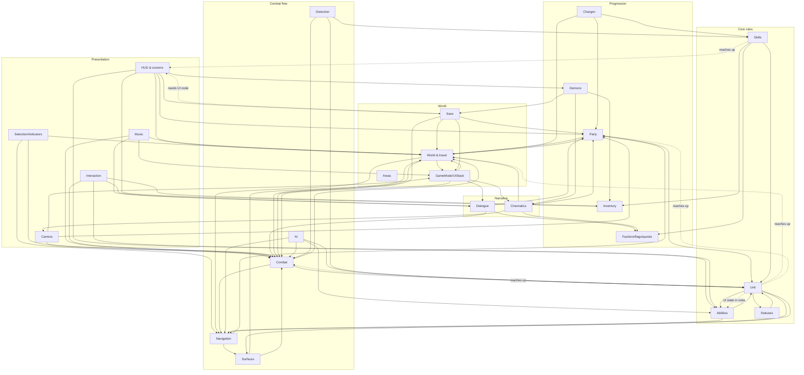

# Systems map

The game, broken into 25 systems. Each doc follows [_TEMPLATE.md](_TEMPLATE.md): purpose, owned state, public surface, dependencies, assumptions, lifecycle, known issues, tests. Every claim carries a file:line.

**How to use this:** before touching a system, read its doc instead of reasoning from memory. After fixing it, update its Known issues table (mark rows FIXED with the commit) and any section the fix changed. A doc that disagrees with the code is a bug in the doc.

Mapped 2026-10-29 at commit 28ba573; reviewed 2026-11-15 at 14cb4ad9. Issue counts are rows in each doc's Known issues table and in its Review 2026-11-15 table.

## Index

| Layer | System | Doc | Issues (10-29) | Review 11-15 |
|---|---|---|---|---|
| **Core rules** | Unit (stats, combat, movement, death, statuses on a unit) | [unit.md](unit.md) | 20 | 18 |
| | Stats (definitions, per-unit instances) | [stats.md](stats.md) | 3 | 2 |
| | Abilities & effects | [abilities.md](abilities.md) | 9 | 6 |
| | Status effects (definitions, behaviors) | [statuses.md](statuses.md) | 7 | 7 |
| | Skills | [skills.md](skills.md) | 8 | 1 |
| **Combat flow** | Combat (CombatManager, Encounter, turns) | [combat.md](combat.md) | 12 | 6 |
| | AI (CombatAi, scorer, archetypes) | [ai.md](ai.md) | 12 | 7 |
| | Surfaces | [surfaces.md](surfaces.md) | 7 | 22 |
| | Detection (notice, join, flee) | [detection.md](detection.md) | 7 | 2 |
| | Navigation (grid, routes, formation) | [navigation.md](navigation.md) | 7 | 23 |
| **World** | World & travel (WorldManager, WorldContext, AreaState) | [world.md](world.md) | 8 | 7 |
| | Areas & bootstrap (MainRoot, game areas, debug spawner) | [areas_bootstrap.md](areas_bootstrap.md) | 8 | 2 |
| | Save/load | [save.md](save.md) | 7 | 4 |
| | Game mode & UI stack | [mode_and_ui_stack.md](mode_and_ui_stack.md) | 5 | 1 |
| **Party & progression** | Party (PartyManager, groups, leader) | [party.md](party.md) | 9 | 4 |
| | Demons (roster, compendium, fusion) | [demons.md](demons.md) | 8 | 6 |
| | Rest (short rest, full rest, supplies) | [rest.md](rest.md) | 3 | 2 |
| | Inventory, stash, currency | [inventory.md](inventory.md) | 11 | 11 |
| | Factions, flags, quests | [factions_flags_quests.md](factions_flags_quests.md) | 9 | 4 |
| | Character creation | [character_creation.md](character_creation.md) | 6 | 6 |
| **Narrative** | Dialogue & negotiation | [dialogue.md](dialogue.md) | 11 | 14 |
| | Cinematics | [cinematics.md](cinematics.md) | 7 | 16 |
| **Input & presentation** | Interaction (menu, click routing) | [interaction.md](interaction.md) | 3 | 9 |
| | Selection & indicators | [selection_indicators.md](selection_indicators.md) | 5 | 5 |
| | Camera | [camera.md](camera.md) | 6 | 1 |
| | HUD & screens (+ log) | [ui.md](ui.md) | 12 | 24 |
| | Music & audio | [music.md](music.md) | 5 | 1 |

## Dependency map

Arrows point from a system to what it reaches into. Lower layers should not reach up; the dotted edges are places they do.

Worst upward reaches, each a known issue:
- **Rules read UI state:** `unit_combat.gd:507-509` reads `AbilityManager.armed_ability` (unit.md #14; U19). Shared targeting Resources read the player's aim from a global (abilities.md ABIL-3).
- ~~**Rules and save depend on a screen:**~~ FIXED (item layer): the party inventory is `PartyManager.inventory`, an ItemContainer; Save and `ItemOwned` no longer need the party screen (inventory.md).
- **Unit calls up into combat flow:** `CombatManager.start_combat_from_hostile_act` from `unit_combat.gd:1304`.
- **Death cleanup knows about cinematics:** `unit_death.gd:110-133` names `StandIn` (unit.md U21, cinematics.md CINE-15).

## The nine root causes

Most issues trace to a few causes. Fixing a cause closes many rows across many docs at once, so the queue below is ordered by cause, not by system.

The review of 2026-11-15 (HEAD 14cb4ad9, the work since 28ba573) added 209 rows, in a "Review 2026-11-15" table in each doc. It kept R1-R6 and added R7-R9. The reviewers proposed more than twenty causes in their own words; each was folded into one of these nine (each row's Root column).

### R1. "One fight, one world" was lifted, but the code that relied on it was never updated
Encounters became per-instance and worlds became resident, but these places still assume a single fight in the single focused world. The new work leans on it in places:
- AI: one global `_acting_unit` / `_move_attempts` (ai.md C-6)
- CombatManager relays `turn_started` and `combat_ended` without saying which fight (combat.md C-7); `focused_encounter` and `watched_fight()` disagree (C-12); restore lookup uses the focused world (C-13). FIXED: `round_started` for surfaces.
- Any `combat_ended` clears all temporary hostility (factions_flags_quests.md C-8); combat end forgets all awareness in the world (detection.md C-18)
- Detection is off in every world while any cutscene plays (detection.md C-5; the gate is intentional, its scope is not)
- A far fight ending disarms the hotbar (ui.md UI-1)
- Deaths recorded in `current_area()`; unit VFX/SFX and ability VFX steps spawn into the focused world (unit.md U9, abilities.md ABIL-12, surfaces.md SURF-14)
- One global surface quiet clock; the grid's active world is hidden state (surfaces.md SURF-17, navigation.md MOVE-12)
- Every camera follows every fight; x-ray and grass trample write global state per world (camera.md, areas_bootstrap.md WLD-16). FIXED: the occupancy snapshot per fight (62f265d4).

### R2. Save is partial and unversioned
- Two serializers for one unit (`Unit.save_state` and the party record); the party one drops statuses, Downed and turn state, so a Downed member reloads standing (unit.md U6, party.md WLD-2)
- Statuses saved by resource path, 23 inline; `on_apply` not restored; toggles and their statuses unsaved, and advantage toggles such as Cling forced back on at load (statuses.md U3-U4, unit.md U5)
- Surfaces, clouds, shots left, the hotbar row count and the fight-music memory are not saved (surfaces.md SURF-15, world.md WLD-3, inventory.md UI-25, ui.md UI-8, music.md CINE-13)
- `resume()` skips turn bookkeeping; a load does not raise `flag_changed` (combat.md C-14, factions_flags_quests.md C-16)
- `FORMAT_VERSION` never read; filenames collide within a second (save.md WLD-11). FIXED: loaded statuses apply their stat modifiers.

### R3. Leaving a mode, or the order of steps, isn't guaranteed
- Load or New Game mid-dialogue leaves `Conversations.current` set: soft-lock; five new listeners wait on the conversation's own end (dialogue.md DLG-1, mode_and_ui_stack.md WLD-10)
- The camp raid: the once-only flag and its payload are set in different places, so a dead cast member makes the fallback black the screen and teleport the party on every arrival, and a refused scene loses the fight (cinematics.md CINE-1, CINE-2, dialogue.md DLG-12). CINE-1 is a bug from 14cb4ad9.
- A carried unit keeps and resumes its old move; `force_stop` resets half the state (navigation.md MOVE-1, MOVE-3)
- A pending walk-then-verb survives cutscenes, world changes and load (interaction.md ABIL-7)
- Presenters and autoloads work only in a fixed add order (dialogue.md DLG-2; `call_deferred` in combat.md C-15, surfaces.md SURF-12)
- `behind_black` drops a second call; game over and Esc ignore its refusal (world.md WLD-9, ui.md UI-20)

### R4. Two answers to one question
- Two fall-damage rules with different safe heights; four landing finders; arc validity by physics, path validity by cells (unit.md MOVE-8, navigation.md MOVE-9, MOVE-11)
- `plan_route` and `preview_route`; threat reach straight-line while movement is routed (navigation.md MOVE-4, ai.md C-9)
- Three answers to "who is the caster" and to "is the world taking input" (interaction.md ABIL-2, ABIL-9)
- Two to-hit numbers; fusion legality in three views; "can this be equipped" in the slot and the unit (ui.md UI-4, UI-23, inventory.md UI-26)
- Three play-then-fight blocks; three "can a body stand here" checks in cinematics; stand-ins with two owners (cinematics.md CINE-3, CINE-10, CINE-7)
- Queries that write: `music_for`, progression reads, the editor rewriting .dlg sources (music.md CINE-13, character_creation.md DLG-24, dialogue.md DLG-6)
- `downed_changed` emitted by hand (unit.md #9, U10). FIXED: one `get_stat`.

### R5. Objects outlive their owner, or owners outlive their objects
- `add_member` returns early, so members built by `embody`/`spawn_group` get no death or Downed wiring: no game over after a load or Retry (party.md WLD-1)
- `carry_tween` overwrites the previous carrier; the ladder route cache holds node refs (navigation.md MOVE-2, MOVE-14)
- The impact wait in `use_ability` has no owner guard (unit.md U8)
- `armed_unit` survives death, Downed and load; freed units stay selected; the menu acts on a stale target (abilities.md ABIL-1, selection_indicators.md ABIL-10, interaction.md ABIL-5)
- A unit with no corpse delay is freed under its stand-in; a stand-in survives its unit leaving the tree (cinematics.md CINE-15, CINE-8)
- A chest reparents the party screen's Inventory widget; shared EquipSlots keep the last unit (inventory.md UI-24, UI-11). FIXED: `became_idle` release (1bf3e4c).

### R6. Exported builds can't find content
Folder scans ignore `.remap`, so in an export the lookups come back empty. Half fixed: dialogue is safe (.dlg plus the export filter), and 3 of 12 catalogs strip `.remap`. Still open: 9 catalogs (world.md WLD-14), DemonDatabase (demons.md DLG-17), the chargen portrait grid, which now blocks Confirm (character_creation.md DLG-21), loot, abilities and skills. Found by reading the code; no export was run.

### R7. No owner named: new mechanics are built beside their system, or in the nearest core file (new)
The cause behind most of the new rows. When a mechanic has no named owner, it lands in one of three places:
- **Beside the owner, as a second path.** Ladders and wall crawl beside the grid, with a second pathfinder behind a hidden flag and three executors in `_step` (navigation.md MOVE-5, MOVE-6, MOVE-7). A second unit serializer (WLD-2). A third way into combat from area scripts (combat.md C-11). The party bootstrap called from three area scripts (areas_bootstrap.md WLD-13).
- **In a core file.** `UnitCombat` hosts five systems that are not combat resolution, and `unit.gd` grows a forward per mechanic (unit.md U1, U2). Every status mechanic costs three edits (statuses.md U13).
- **In an area script.** The quarry script is the quest script: it counts deaths, completes the quest, holds raiders out of the tree and runs the raid (cinematics.md CINE-6, CINE-4; factions_flags_quests.md C-17). This is how battle music nearly landed on a unit export.

The cure is the rule now in force: a new mechanic names the system that owns it and updates that system's doc in the same commit; a workaround says so in its commit and gets a row here.

### R8. General code names specific content or types (new)
Engine layers ask "is it this class" or name one piece of content instead of asking the object: `townsfolk` in the AI driver, the one faction relation hard-coded, `Ladder` by class in "can it ever reach", AI and indicators reading ability mechanics by type test, a seven-probe duck-typed surface visual, item kinds by `is` (ai.md C-1, C-3, C-4; factions_flags_quests.md C-2; unit.md U12; selection_indicators.md ABIL-14; surfaces.md SURF-1, SURF-2; inventory.md UI-30). Each new content type then means edits in engine code.

### R9. Rules live in views and presenters (new)
Screens compute rules the model should answer, and only some follow changes: the hotbar slot builds its own "can this be used" and its own to-hit; Aim and Deceptive are named in the dock; game over ends fights and picks the winner; views choose their own signals, and some are snapshots (ui.md UI-3, UI-4, UI-5, UI-9, UI-10, UI-18). The player's aim lives in a global that shared targeting Resources read (abilities.md ABIL-3). The dialogue camera turns because the UI band says so, and two clocks time a line (dialogue.md DLG-3, DLG-4).

## Fix queue

Each step is one system-scoped change set: fix it, verify it, update its doc, commit. Ordered by root cause; earlier steps make later ones safer. Sizes: S under a day, M a few days, L a week or more, XL a rework.

| # | Step | Root cause | Rows | Size | Why here |
|---|---|---|---|---|---|
| 1 | Mode and story exits: `Conversations` ends on world_loading and new game; UIStack honors `can_open`; the raid sets its once-only flag where its payload runs, never fires twice, and starts the fight even when the scene is refused | R3 | DLG-1, WLD-10, CINE-1, CINE-2, DLG-12 | S-M | Soft-locks and a repeating teleport today; CINE-1 is from the last commit |
| 2 | Lifecycle guards: `add_member` wiring (game over after load), carrier and `force_stop`, impact-wait guard, clear `armed_unit` and freed selections, cancel a pending approach on cutscene, world change and load, stand-in holds the corpse by token | R5 (R3) | WLD-1, MOVE-1-3, U8, ABIL-1, ABIL-5, ABIL-7, ABIL-10, CINE-7, CINE-8, CINE-15 | M | Wrong-state and crash bugs; each fix is local |
| 3 | Per-encounter combat: AI state per encounter, relays carry the encounter (the dock uses it), hostility and awareness per encounter, detection gate per world, `area_of` for deaths, VFX and surfaces parented to the unit's world | R1 | C-5-8, C-12, C-13, C-18, UI-1, U9, ABIL-12, SURF-14, SURF-17, MOVE-12, MOVE-13 | L | The widest cause; Combat first, then its listeners |
| 4 | One truth per question: one fall rule and one landing finder, Downed signal from the status, to-hit, fusion legality and equip checks asked of the model, one cinematic ground helper and one play-then-fight helper | R4 | MOVE-8-11, U10, UI-4, UI-23, UI-26, CINE-3, CINE-10 | L | Must precede save work, which serializes this state |
| 5 | Save foundation: one `Unit.save_state` used by the party, statuses as files with stable ids and `on_restore`, toggles saved (stop forcing Cling on), shots left, surfaces and clouds per world, versioned slots, resume bookkeeping | R2 | U3-U6, WLD-2, WLD-3, SURF-15, UI-25, C-14, WLD-11 | XL | Content can't grow safely until saves are stable; Cling (U5) and shots left (UI-25) are S and can go first |
| 6 | Export-safe content scans: one shared helper for every catalog, the portraits and DemonDatabase | R6 | WLD-14, DLG-17, DLG-21, UI-29, U24 | M | One helper; before the first export test |
| 7 | Owners: a story/quest layer that owns area-scripted steps (camp raid, ambush, quest counting); a TravelMode on UnitMovement that ladders, crawl and jump plug into; split UnitCombat by what it hosts | R7 | CINE-4, CINE-6, C-11, C-17, MOVE-5-7, U1, U2, U13 | XL | Structural; do each part when the next mechanic in that area is due, never as a big-bang rework |
| 8 | Ask the object: virtuals in place of type tests and named content in AI, indicators, surfaces and items | R8 | C-1-4, U12, ABIL-14, SURF-1, SURF-2, UI-30 | M each | Cheap once the owners in step 7 exist |
| 9 | Rules out of views: the hotbar and screens ask the unit; aim owned by the router, not a global; views follow change signals | R9 | UI-3-5, UI-9, UI-10, UI-18, ABIL-3, DLG-3, DLG-4 | L | Presentation polish will touch these screens anyway |
| 10 | The rest, per system, as content needs it | n/a | each doc's remaining rows | n/a | n/a |
